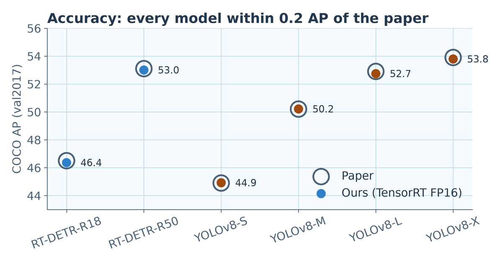
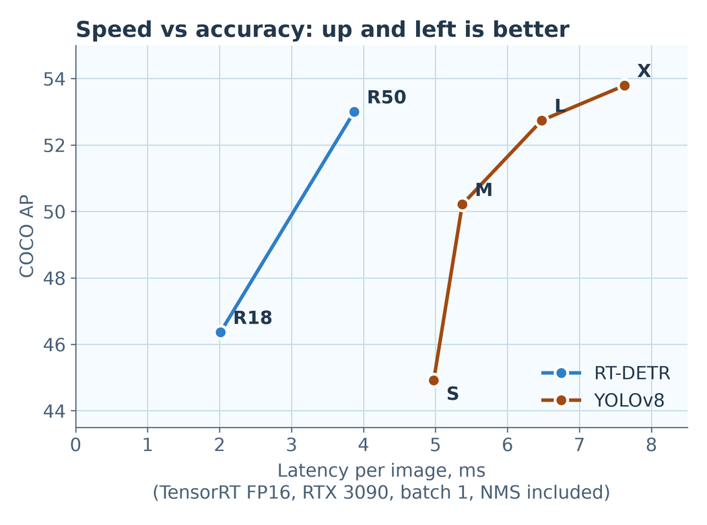
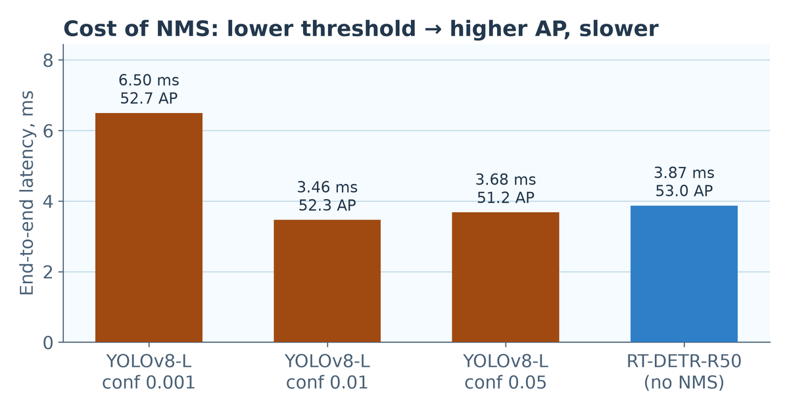
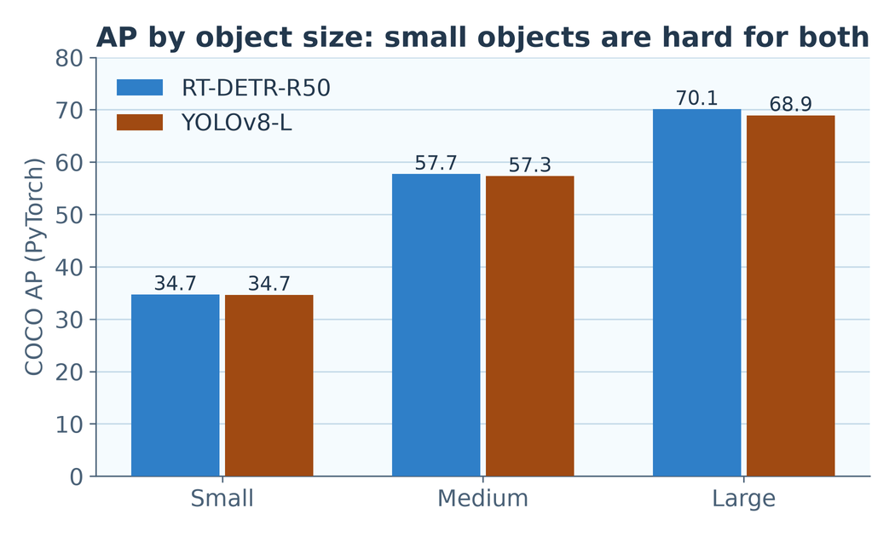
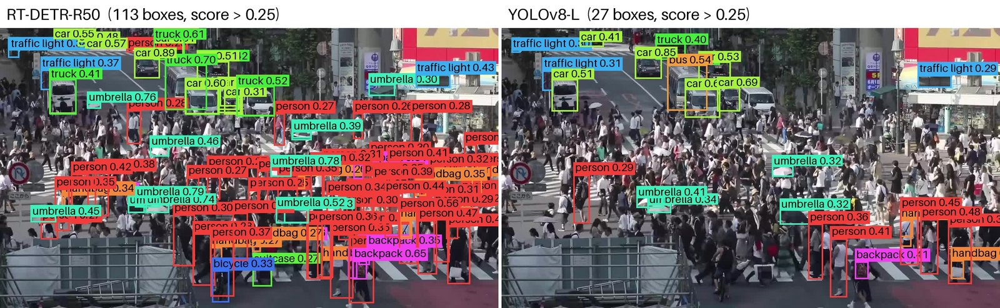
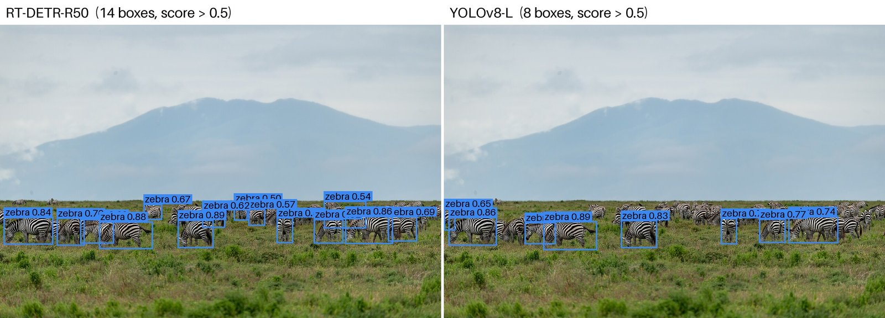
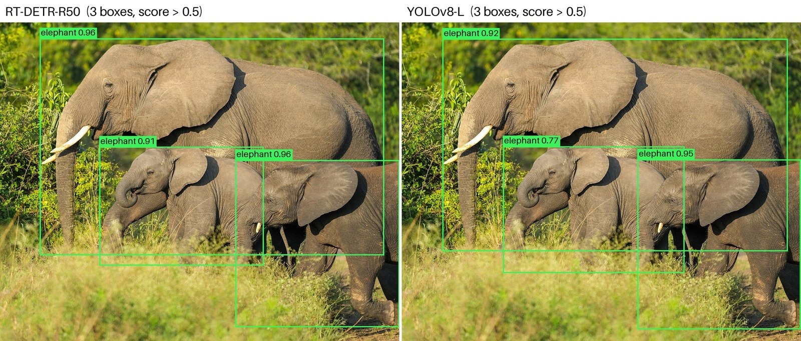

# RT-DETR From Scratch

A from-scratch PyTorch reimplementation of **RT-DETR**, benchmarked against YOLOv8 with TensorRT.

> **DETRs Beat YOLOs on Real-time Object Detection** — Zhao et al., CVPR 2024 · [arXiv:2304.08069](https://arxiv.org/abs/2304.08069)

📊 Presentation: [slides (PDF)](docs/RT-DETR_presentation.pdf) · [PowerPoint](docs/RT-DETR_presentation.pptx)

## Results at a glance

- ✅ **Accuracy reproduced:** our model gets **46.4 / 53.1 AP** (R18 / R50) on COCO val2017, against the paper's 46.5 / 53.1.
- ✅ **Same model as the authors':** loaded with their weights, our outputs differ from theirs by at most **3.7 × 10⁻⁶** (R18).
- ✅ **Speed claim reproduced:** with TensorRT FP16, RT-DETR-R50 runs **1.67× faster** than YOLOv8-L at the same accuracy (paper: 1.52×).
- ✅ **No NMS:** YOLOv8-L's end-to-end time almost doubles at its best-accuracy setting (3.46 → 6.50 ms) because of NMS. RT-DETR has no NMS step and no threshold to tune.

## Why this paper

Before RT-DETR, there were two kinds of detector:
- **YOLO** is fast, but it needs **NMS** after the network to delete duplicate boxes. NMS adds latency and two thresholds to tune, and in crowds it can delete real objects.
- **DETR** needs no NMS, because each object gets exactly one prediction. But it was far too slow for real time.

RT-DETR was the first detector to combine both: **end-to-end (NMS-free) and real-time**. It's the base of the real-time DETR family that followed (e.g. RT-DETRv2, D-FINE, DEIM).

We chose to implement it because:
1. **It answers a clear question:** can a transformer detector beat YOLO on speed *and* accuracy? We can test that claim on our own hardware.
2. **Every part can be built and checked:** a ResNet backbone, a hybrid encoder (AIFI + CCFF), query selection, a deformable decoder, Hungarian matching and the losses. We wrote all of them and verified each one against the authors' model.

## Paper vs ours

All of our numbers are on COCO val2017 (5,000 images), measured on an **RTX 3090** with **TensorRT 10.16 FP16** at batch 1. The paper used a **T4**.

### Accuracy (COCO AP)

| Model | Paper | Ours (PyTorch) | Ours (TensorRT FP16) |
|---|---|---|---|
| **RT-DETR-R18** | 46.5 | **46.4** | **46.4** |
| **RT-DETR-R50** | 53.1 | **53.1** | **53.0** |
| YOLOv8-S | 44.9 | 44.3 | 44.9 |
| YOLOv8-M | 50.2 | 49.5 | 50.2 |
| YOLOv8-L | 52.9 | 52.1 | 52.7 |
| YOLOv8-X | 53.9 | 53.1 | 53.8 |

The FP16 engines lose under 0.1 AP compared with PyTorch. YOLO's PyTorch column comes from ultralytics `predict()`, which pre-processes slightly differently from the official val. Our TensorRT path letterboxes exactly like val and matches the paper.

### Speed (end-to-end, NMS included for YOLO)

| Model | Params | GFLOPs | Paper FPS (T4) | **Our FPS (3090)** | Our latency |
|---|---|---|---|---|---|
| **RT-DETR-R18** | 20.2 M | 61.5 | 217 | **497** | 2.01 ms |
| **RT-DETR-R50** | 42.9 M | 137.8 | 108 | **258** | 3.87 ms |
| YOLOv8-S | 11 M | 29 | — | 201 | 4.98 ms |
| YOLOv8-M | 26 M | 79 | — | 186 | 5.37 ms |
| YOLOv8-L | 43 M | 165 | 71 | 154 | 6.48 ms |
| YOLOv8-X | 68 M | 257 | 50 | 131 | 7.63 ms |

**RT-DETR-R50 ÷ YOLOv8-L FPS: 1.52× (paper) → 1.67× (ours).**

Every model runs about 2.3× faster on our 3090 than on the paper's T4, because the 3090 is a faster GPU. So compare the **ratios**, not the absolute FPS. YOLO is timed at NMS score threshold 0.001, the paper's best-accuracy setting.

### The cost of NMS (YOLOv8-L)

| Score threshold | Paper AP | Paper NMS time | **Our AP** | **Our end-to-end** |
|---|---|---|---|---|
| 0.001 | 52.9 | 2.36 ms | 52.7 | 6.50 ms |
| 0.01 | 52.4 | 1.73 ms | 52.3 | 3.46 ms |
| 0.05 | 51.2 | 1.06 ms | 51.2 | 3.68 ms |
| *RT-DETR-R50* | *—* | ***0 ms (no NMS)*** | *53.0* | *3.87 ms* |

A lower threshold gives YOLO more AP but more boxes to filter. NMS runs inside our YOLO engines, so we report end-to-end time, not NMS time alone.

### Plots

| | |
|---|---|
|  |  |
|  |  |

**AP by object size** (bottom right): R50 and YOLOv8-L tie on small objects (34.7 each), and RT-DETR is ahead on medium and large ones. The paper reports RT-DETR slightly behind YOLO on small objects; for this pair we measured a tie.

### Example detections (RT-DETR-R50 vs YOLOv8-L, same score threshold)

**Crowds:** YOLO's NMS deletes overlapping people as duplicates. RT-DETR keeps one box per person. *(Shibuya crossing, score > 0.25: 113 vs 27 boxes.)*



**Overlapping animals:** a dense zebra herd gives 14 vs 8 zebras. In the elephant photo, RT-DETR is more confident on the half-hidden calf (0.91 vs 0.77).




## What we built

| Part | Code | Checked against the authors' model (max abs diff) |
|---|---|---|
| Backbone: ResNet-vd R18 / R50 | `src/backbone/` | exact (0.0) |
| Hybrid encoder: AIFI (attention on S5 only) + CCFF | `src/encoder/` | ≤ 1.1e-5 |
| Uncertainty-minimal query selection (top-300) | `src/decoder/rtdetr_transformer.py` | identical selection |
| Deformable-attention decoder (3 / 6 layers) | `src/decoder/` | ≤ 1e-4 |
| Contrastive denoising | `src/decoder/denoising.py` | bit-identical (same seed) |
| Hungarian matcher | `src/matcher/` | identical matches |
| Losses: VFL + L1 + GIoU | `src/losses/` | ≤ 1e-5 |
| **Whole model, image → boxes** | `src/model.py` | **3.7e-6 (R18), 2.1e-5 (R50)** |
| ONNX → TensorRT export (RT-DETR, and YOLOv8 + EfficientNMS) | `scripts/export_trt.py`, `src/utils/trt.py` | FP16 engine within 0.1 AP |

The authors' pretrained weights (`PekingU/rtdetr_r18vd`, `rtdetr_r50vd`) load into our modules by renaming keys (`src/utils/hf_weights.py`). We didn't re-train; the matcher, losses and denoising are implemented for training and match the reference losses. The parity checks above come from the 137 unit and parity tests we ran during development; they're kept in the git history (`git show f6b3ad9:tests/`).

## Quick start

```bash
git clone https://github.com/Sulojan2027/rt-detr-from-scratch.git && cd rt-detr-from-scratch
conda env create -f environment.yml && conda activate rtdetr     # or: pip install -r requirements.txt
```

**Data:** download COCO `val2017.zip` and `annotations_trainval2017.zip` from [cocodataset.org](https://cocodataset.org/#download) and unzip them into `data/coco/` (`annotations/instances_val2017.json`, `val2017/`).

| Task | Command |
|---|---|
| COCO AP of our model | `python scripts/eval.py --depth 50 --coco data/coco --mode full` |
| Build a TensorRT engine (+ its AP) | `python scripts/export_trt.py --model rtdetr_r50 --check-ap` |
| All benchmarks (dry run, then full) | `LIMIT=50 bash scripts/run_all.sh` → `bash scripts/run_all.sh` |
| Plots from the results | `python scripts/plot_results.py` |
| Side-by-side images | `python scripts/visualize.py --images path/to/photo.jpg` |

You need an NVIDIA GPU with TensorRT 10.x for the engines. Our setup: Python 3.11, PyTorch 2.6 (CUDA 12.4), TensorRT 10.16.

## Repo structure

```
src/
├── backbone/      ResNet-vd (PResNet)
├── encoder/       AIFI, CCFF, HybridEncoder
├── decoder/       query selection, deformable attention, decoder, denoising
├── matcher/       Hungarian matcher
├── losses/        VFL + L1 + GIoU
├── data/ eval/    COCO dataset, transforms, COCO AP
├── utils/         HF weight mapping, box ops, TensorRT runner
├── model.py       RTDETR (whole model) + RTDETRDeploy (ONNX / TensorRT)
└── postprocess.py logits/boxes → detections
scripts/           eval, export_trt, benchmark, run_all, plot_results, visualize
docs/              presentation slides (PDF, PPTX) and README figures
```

## Team

| Member | Focus |
|---|---|
| Sulojan | Backbone, hybrid encoder (AIFI + CCFF), TensorRT export and benchmarks |
| Praveen | Query selection, decoder, matcher, losses |
| Both | Post-processing, data pipeline, COCO evaluation |

## References and credits

- Paper: [arXiv:2304.08069](https://arxiv.org/abs/2304.08069) · official code: [lyuwenyu/RT-DETR](https://github.com/lyuwenyu/RT-DETR) · [Hugging Face RT-DETR](https://github.com/huggingface/transformers/tree/main/src/transformers/models/rt_detr)
- YOLOv8: [ultralytics](https://github.com/ultralytics/ultralytics) · background: [Deformable DETR](https://arxiv.org/abs/2010.04159)
- Example media (Wikimedia Commons): elephants by Giles Laurent (CC BY-SA 4.0), zebras by Eric Kilby (CC BY-SA 2.0), Shibuya crossing video by Basile Morin (CC BY-SA 4.0).

## License

Apache 2.0, the same as the official RT-DETR repo. See [`LICENSE`](LICENSE).
